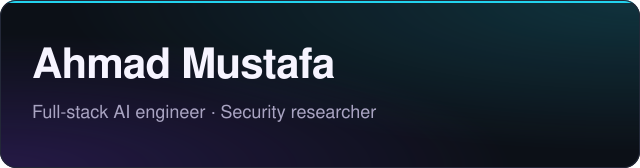

  

I build AI-powered systems, then measure whether the agents inside them stay inside their authority. The product stack is React, Next.js, Node.js, and PostgreSQL. The part I spend the most time on is the boundary around the model: tool calls, provenance, and prompt injection.

Full-stack developer at **Placentek**. AI Lead of the **AWS Student Builder Group** at COMSATS University Islamabad. BS Computer Science, class of 2027, based in Islamabad.

[Portfolio](https://ahmadmustafa.me) · [LinkedIn](https://www.linkedin.com/in/ahmadmustafabutt) · [Email](mailto:ahmadmustafabutt.dev@gmail.com)

## Selected work

### [Warrant](https://github.com/ahmadmustafa02/warrant) — authorization for AI agents

[Lab](https://warrant-lab.vercel.app/) · [Source](https://github.com/ahmadmustafa02/warrant)

A provenance guard for tool-using agents. It freezes the user's original request and blocks sensitive tool calls that request did not authorize. It ships as a framework-free TypeScript guard and a CLI proxy (`@warrant-lab/guard`, `@warrant-lab/cli`). I designed and built it as the capstone of an AI engineering internship at Arbisoft.

On one sandbox agent, with the guard on: **60/60** tuned attacks stopped, **15/15** held-out attacks stopped, and **22/24** ordinary tasks still completed.

### [CodePulse](https://github.com/ahmadmustafa02/CodePulse) — pull-request review

[Live](https://getcodepulse.vercel.app/) · [Source](https://github.com/ahmadmustafa02/CodePulse)

A GitHub App that posts exact-line review comments with severity, and sends the team a weekly coaching digest. Untrusted pull-request content is checked for prompt injection before the model runs. Jobs are durable, traced, and isolated per installation.

## Research

Two empirical studies on the security of AI-authored code. The pipelines, tables, and figures are public.

### [When AI agents change dependencies](https://github.com/ahmadmustafa02/ai-agent-dependency-vulns)

17,727 pull requests from Devin, Codex, Copilot, Cursor, and Claude Code, matched with human pull requests from the same repositories and time windows. Every changed manifest was scanned with OSV-Scanner. AI-agent pull requests introduced a known-vulnerable dependency **17.17%** of the time, against **9.14%** for human pull requests. Odds ratio **2.06** (95% CI 1.76–2.41).

### [Cross-project vulnerability detection](https://github.com/ahmadmustafa02/cross-project-vulnerability-detection)

Random Forest and CodeBERT, trained and tested across nine PrimeVul codebases, including Linux and Chrome, with one shared occlusion explainer. Predictive performance collapsed across projects. Mean MCC fell from **0.189 to 0.005** for the classical model and from **0.169 to 0.050** for CodeBERT. Explanation stability dropped as well, and by less than performance did.

## Open source

Two pull requests merged into [Pipedream](https://github.com/PipedreamHQ/pipedream), now part of Workday.

- [**#21505 — Adobe PDF extraction**](https://github.com/PipedreamHQ/pipedream/pull/21505). Text and table extraction was failing on every call after a hidden SDK version mismatch. I migrated the action to SDK v4, and the eval suite passed after the merge.
- [**#21452 — Jira Download Attachment**](https://github.com/PipedreamHQ/pipedream/pull/21452). Authenticated binary download, with path-traversal checks and numeric ID validation.

## Experience

**Placentek** · Full-stack developer · 2026–present
Shipped a production RAG shopping assistant on WooCommerce. Answers are grounded in live product and inventory data, so price and fitment stay tied to the catalog. JWT auth and indexed PostgreSQL queries cut average API response time by about 35%.

**AWS Student Builder Group, COMSATS** · AI Lead · 2026–present
Workshops and student projects on LLMs, cloud, and applied AI.

**Arbisoft** · AI-focused software engineering intern · Aug–Oct 2026
Eight weeks on agentic systems: skills, memory, hooks, and MCP. Warrant was the capstone, from the proposal through mentor review to the shipped guard.

**Vynora Labs** · Full-stack developer · 2025–2026
LLM-backed SaaS. React and Tailwind on Node.js and Express, plus auth, schemas, and REST APIs.

BS Computer Science, COMSATS University Islamabad, 2023–2027.

Silver tier at the Google Antigravity National Hackathon 2026, for Ingridio, a fridge-photo recipe guide built in a day during exams. Machine Learning Specialization, DeepLearning.AI. Introduction to the Model Context Protocol, Anthropic.

## Stack

TypeScript, Python, and SQL. React, Next.js, Node.js, PostgreSQL, and Redis. LangChain, LangGraph, RAG, and MCP. Docker, GitHub Actions, and Vercel.

---

Islamabad. I read what reaches [ahmadmustafabutt.dev@gmail.com](mailto:ahmadmustafabutt.dev@gmail.com). Open to full-stack and AI product engineering roles.
